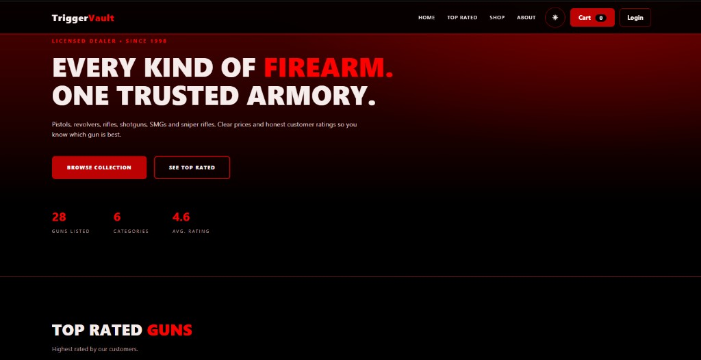
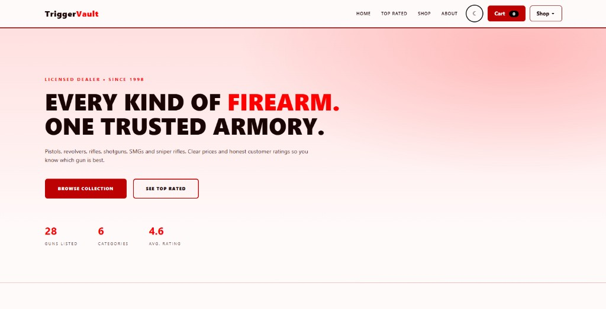
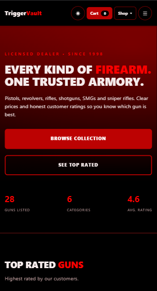
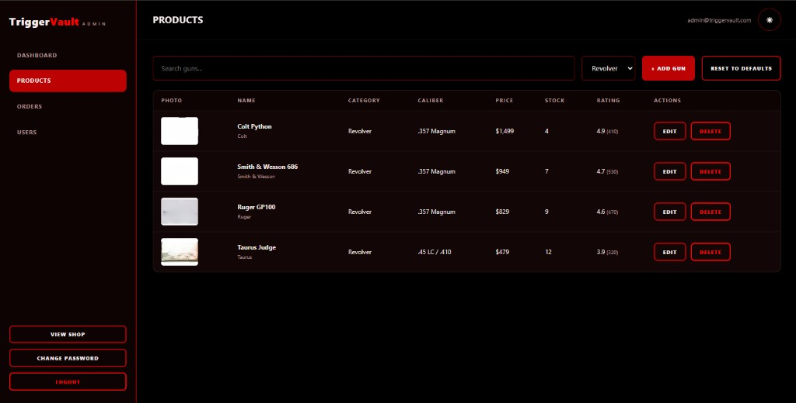

# TriggerVault

A full-stack e-commerce **demo project** with a firearms-store theme, built to practise web development and secure backend design.

> **Demo only.** TriggerVault is a portfolio / learning project. It is not a real shop, nothing is sold, and no real orders are processed.

## Screenshots

| Night mode | Day mode |
|---|---|
|  |  |

| Mobile | Admin panel |
|---|---|
|  |  |

## Features

- 28 products in 6 categories (Pistol, Revolver, Rifle, Shotgun, SMG, Sniper) with price, stock and customer ratings
- Search, category filters and sorting (featured, rating, price, name)
- Day / Night theme toggle
- Fully responsive layout for phones, tablets and desktops
- 18+ age-verification gate on every new visit
- Customer accounts: register, login, rate products, cart, checkout and order tracking
- Admin panel: dashboard, product management (with photo upload), order status updates, user management, change password

## Tech stack

- **Frontend:** HTML, CSS, vanilla JavaScript
- **Backend:** Node.js, Express
- **Storage:** JSON file database (`data/db.json`)
- **Security:** bcrypt, helmet

## Security highlights

- Passwords hashed with bcrypt (cost 12)
- Session in an HttpOnly, SameSite=Strict cookie
- CSRF protection (token + Origin check) on every state-changing request
- Strict Content-Security-Policy (no inline scripts)
- Rate limiting on login, registration and orders
- Server-side validation; prices and stock are decided by the server, never the browser
- Admin routes verify the admin role on the server
- Image uploads checked by file signature and size
- Private files (`.env`, `data/`, server code) are never served to the browser

The page source of any website is always visible in the browser. TriggerVault keeps no secrets in the front-end; all sensitive data and logic live on the server.

## Run locally

Requires [Node.js](https://nodejs.org) (LTS).

```bash
git clone https://github.com/istiakmahmudnewaz/TriggerVault-Gun-Shop.git
cd TriggerVault-Gun-Shop
npm install
cp .env.example .env     # on Windows: copy .env.example .env
# edit .env and set ADMIN_EMAIL and a strong ADMIN_PASSWORD (min 10 characters)
npm start
```

Open http://localhost:3000 and the admin panel at http://localhost:3000/admin.html.

The admin account is created from `.env` on the first start. After that you can remove `ADMIN_PASSWORD` from `.env` and change the password inside the admin panel.

On Windows you can also double-click `start.bat`.

## Deployment notes

The app is a long-running Node server that writes to local files, so it needs a host with a persistent disk (for example Render, Railway or Fly.io). It will not work on serverless platforms such as Vercel without moving to an external database and file storage. When online, use HTTPS, set `NODE_ENV=production` and set `TRUST_PROXY` correctly.

## Credits

- Product photos come from [Wikimedia Commons](https://commons.wikimedia.org/); authors and licenses are listed in [`public/assets/credits.json`](public/assets/credits.json).
- All product names and trademarks belong to their respective owners. This project is not affiliated with or endorsed by any manufacturer.

## Author

Designed & Developed by [Istiak Mahmud Newaz](https://istiakmahmudnewaz.vercel.app/)
